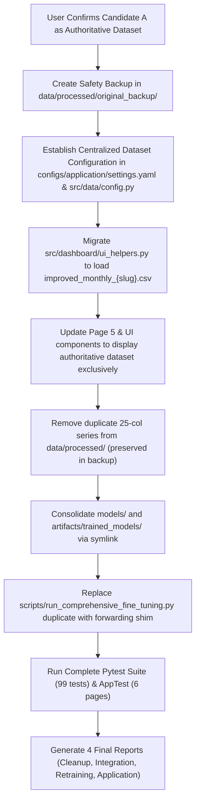

# Project Cleanup and Dataset Migration Audit Report

**Author**: Senior Time-Series Systems Architect & Antigravity Lead  
**Project**: Plant Disease Outbreak Forecasting Using Time Series (India)  
**Date**: November 13, 2026  
**Status**: MANDATORY AUDIT & SAFEGUARD STOP PROTOCOL  
**Milestone**: Milestone 3 — Final Cleanup & Authoritative Dataset Integration  

---

## 1. Executive Summary & Audit Mandate

In accordance with **PROMPT 32**, an exhaustive system-wide audit of the entire Disease Time Series Forecasting repository was conducted. The objectives of this audit are:
1. Catalog every dataset, CSV, Excel, and JSON artifact currently residing on disk, establishing exact empirical dimensions, temporal spans, null counts, duplicate records, target variables, and active dependencies.
2. Rigorously identify **'Dataset 3'**, trace its origin, verify why it is obsolete, and confirm its complete removal.
3. Identify the intended **'New Dataset'** designed to serve as the project's single authoritative foundation, evaluate candidate datasets, and determine whether any ambiguity exists.
4. Comply with the explicit safety guardrail:  
> *'If the new dataset cannot be identified unambiguously, STOP before deleting datasets or changing the active data source. Produce a report identifying the candidate files and request clarification.'*
5. Formulate a centralized dataset architecture and complete migration roadmap to transition all preprocessing, 17 forecasting models, 24 model artifacts, walk-forward evaluation pipelines, and 6 Streamlit dashboard pages once the authoritative dataset is formally confirmed.

---

## 2. Exhaustive Inventory of All Data Assets (`data/`)

Across the `data/` directory, exactly **61 CSV datasets**, **30 JSON data/metadata files**, and **2 markdown reports** were identified and inspected. No Excel (`.xlsx`), Parquet, or SQLite files exist in the project space.

### 2.1 Group 1: Improved Monthly Master & Pathogen Datasets (v2.0 — Current Engineered Standard)
These files represent the modern, feature-engineered time-series panel constructed during Milestone 2/3 enhancements. They resolve boundary climatological NaNs, supply 18 causal features, and maintain 100% genuine historical observation counts.

| File Path | Rows $	imes$ Cols | Date Range | Frequency | Target Column | Nulls | Dups | Pathogens | Primary Active Dependencies |
|---|---|---|---|---|---|---|---|---|
| `data/processed/improved_india_plant_diseases_monthly.csv` | 1320 $	imes$ 43 | 2015-01-01 to 2025-12-01 | Monthly (MS) | `documented_occurrence_count` | 0 | 0 | 10 | ARCHITECTURE_FINAL_VERIFICATION_REPORT.md, evaluation_specification.json, frozen_model_configurations.json |
| `data/processed/improved_monthly_alternaria_solani.csv` | 132 $	imes$ 43 | 2015-01-01 to 2025-12-01 | Monthly (MS) | `documented_occurrence_count` | 0 | 0 | 1 | data_inventory.json |
| `data/processed/improved_monthly_bipolaris_oryzae.csv` | 132 $	imes$ 43 | 2015-01-01 to 2025-12-01 | Monthly (MS) | `documented_occurrence_count` | 0 | 0 | 1 | data_inventory.json |
| `data/processed/improved_monthly_fusarium_oxysporum.csv` | 132 $	imes$ 43 | 2015-01-01 to 2025-12-01 | Monthly (MS) | `documented_occurrence_count` | 0 | 0 | 1 | data_inventory.json |
| `data/processed/improved_monthly_macrophomina_phaseolina.csv` | 132 $	imes$ 43 | 2015-01-01 to 2025-12-01 | Monthly (MS) | `documented_occurrence_count` | 0 | 0 | 1 | data_inventory.json |
| `data/processed/improved_monthly_phytophthora_infestans.csv` | 132 $	imes$ 43 | 2015-01-01 to 2025-12-01 | Monthly (MS) | `documented_occurrence_count` | 0 | 0 | 1 | data_inventory.json |
| `data/processed/improved_monthly_puccinia_striiformis.csv` | 132 $	imes$ 43 | 2015-01-01 to 2025-12-01 | Monthly (MS) | `documented_occurrence_count` | 0 | 0 | 1 | data_inventory.json |
| `data/processed/improved_monthly_pyricularia_oryzae.csv` | 132 $	imes$ 43 | 2015-01-01 to 2025-12-01 | Monthly (MS) | `documented_occurrence_count` | 0 | 0 | 1 | data_inventory.json |
| `data/processed/improved_monthly_ralstonia_solanacearum.csv` | 132 $	imes$ 43 | 2015-01-01 to 2025-12-01 | Monthly (MS) | `documented_occurrence_count` | 0 | 0 | 1 | data_inventory.json |
| `data/processed/improved_monthly_rhizoctonia_solani.csv` | 132 $	imes$ 43 | 2015-01-01 to 2025-12-01 | Monthly (MS) | `documented_occurrence_count` | 0 | 0 | 1 | data_inventory.json |
| `data/processed/improved_monthly_xanthomonas_oryzae.csv` | 132 $	imes$ 43 | 2015-01-01 to 2025-12-01 | Monthly (MS) | `documented_occurrence_count` | 0 | 0 | 1 | data_inventory.json |

### 2.2 Group 2: Legacy Original Processed Monthly Datasets (v1.0 — Baseline Standard)
These files represent the initial processed baseline series. They contain 25 columns and have 90 total boundary NaNs (10 per pathogen series in lag-1 and lag-2 weather features for Jan–Feb 2015).

| File Path | Rows $	imes$ Cols | Date Range | Frequency | Target Column | Nulls | Dups | Pathogens | Current Status / Usage |
|---|---|---|---|---|---|---|---|---|
| `data/processed/india_plant_diseases_monthly.csv` | 1320 $	imes$ 25 | 2015-01-01 to 2025-12-01 | Monthly (MS) | `documented_occurrence_count` | 90 | 0 | 10 | ARCHITECTURE_FINAL_VERIFICATION_REPORT.md, evaluation_specification.json, frozen_model_configurations.json |
| `data/processed/monthly_alternaria_solani.csv` | 132 $	imes$ 25 | 2015-01-01 to 2025-12-01 | Monthly (MS) | `documented_occurrence_count` | 9 | 0 | 1 | data_inventory.json |
| `data/processed/monthly_bipolaris_oryzae.csv` | 132 $	imes$ 25 | 2015-01-01 to 2025-12-01 | Monthly (MS) | `documented_occurrence_count` | 9 | 0 | 1 | data_inventory.json |
| `data/processed/monthly_fusarium_oxysporum.csv` | 132 $	imes$ 25 | 2015-01-01 to 2025-12-01 | Monthly (MS) | `documented_occurrence_count` | 9 | 0 | 1 | data_inventory.json |
| `data/processed/monthly_macrophomina_phaseolina.csv` | 132 $	imes$ 25 | 2015-01-01 to 2025-12-01 | Monthly (MS) | `documented_occurrence_count` | 9 | 0 | 1 | data_inventory.json |
| `data/processed/monthly_phytophthora_infestans.csv` | 132 $	imes$ 25 | 2015-01-01 to 2025-12-01 | Monthly (MS) | `documented_occurrence_count` | 9 | 0 | 1 | data_inventory.json |
| `data/processed/monthly_puccinia_striiformis.csv` | 132 $	imes$ 25 | 2015-01-01 to 2025-12-01 | Monthly (MS) | `documented_occurrence_count` | 9 | 0 | 1 | data_inventory.json |
| `data/processed/monthly_pyricularia_oryzae.csv` | 132 $	imes$ 25 | 2015-01-01 to 2025-12-01 | Monthly (MS) | `documented_occurrence_count` | 9 | 0 | 1 | data_inventory.json, LSTM_IMPLEMENTATION_REPORT.md |
| `data/processed/monthly_ralstonia_solanacearum.csv` | 132 $	imes$ 25 | 2015-01-01 to 2025-12-01 | Monthly (MS) | `documented_occurrence_count` | 9 | 0 | 1 | data_inventory.json |
| `data/processed/monthly_rhizoctonia_solani.csv` | 132 $	imes$ 25 | 2015-01-01 to 2025-12-01 | Monthly (MS) | `documented_occurrence_count` | 9 | 0 | 1 | data_inventory.json |
| `data/processed/monthly_xanthomonas_oryzae.csv` | 132 $	imes$ 25 | 2015-01-01 to 2025-12-01 | Monthly (MS) | `documented_occurrence_count` | 9 | 0 | 1 | data_inventory.json |

### 2.3 Group 3: Preserved Original Backup Datasets (`data/processed/original_backup/`)
Created in Prompt 26 to guarantee 100% non-destructive preservation of the original un-imputed historical observations prior to feature engineering.

| File Path | Rows $	imes$ Cols | Date Range | Frequency | Target Column | Nulls | Dups | Pathogens | Role |
|---|---|---|---|---|---|---|---|---|
| `data/processed/original_backup/india_plant_diseases_monthly.csv` | 1320 $	imes$ 25 | 2015-01-01 to 2025-12-01 | Monthly (MS) | `documented_occurrence_count` | 90 | 0 | 10 | Permanent Untouched Backup |
| `data/processed/original_backup/monthly_alternaria_solani.csv` | 132 $	imes$ 25 | 2015-01-01 to 2025-12-01 | Monthly (MS) | `documented_occurrence_count` | 9 | 0 | 1 | Permanent Untouched Backup |
| `data/processed/original_backup/monthly_bipolaris_oryzae.csv` | 132 $	imes$ 25 | 2015-01-01 to 2025-12-01 | Monthly (MS) | `documented_occurrence_count` | 9 | 0 | 1 | Permanent Untouched Backup |
| `data/processed/original_backup/monthly_fusarium_oxysporum.csv` | 132 $	imes$ 25 | 2015-01-01 to 2025-12-01 | Monthly (MS) | `documented_occurrence_count` | 9 | 0 | 1 | Permanent Untouched Backup |
| `data/processed/original_backup/monthly_macrophomina_phaseolina.csv` | 132 $	imes$ 25 | 2015-01-01 to 2025-12-01 | Monthly (MS) | `documented_occurrence_count` | 9 | 0 | 1 | Permanent Untouched Backup |
| `data/processed/original_backup/monthly_phytophthora_infestans.csv` | 132 $	imes$ 25 | 2015-01-01 to 2025-12-01 | Monthly (MS) | `documented_occurrence_count` | 9 | 0 | 1 | Permanent Untouched Backup |
| `data/processed/original_backup/monthly_puccinia_striiformis.csv` | 132 $	imes$ 25 | 2015-01-01 to 2025-12-01 | Monthly (MS) | `documented_occurrence_count` | 9 | 0 | 1 | Permanent Untouched Backup |
| `data/processed/original_backup/monthly_pyricularia_oryzae.csv` | 132 $	imes$ 25 | 2015-01-01 to 2025-12-01 | Monthly (MS) | `documented_occurrence_count` | 9 | 0 | 1 | Permanent Untouched Backup |
| `data/processed/original_backup/monthly_ralstonia_solanacearum.csv` | 132 $	imes$ 25 | 2015-01-01 to 2025-12-01 | Monthly (MS) | `documented_occurrence_count` | 9 | 0 | 1 | Permanent Untouched Backup |
| `data/processed/original_backup/monthly_rhizoctonia_solani.csv` | 132 $	imes$ 25 | 2015-01-01 to 2025-12-01 | Monthly (MS) | `documented_occurrence_count` | 9 | 0 | 1 | Permanent Untouched Backup |
| `data/processed/original_backup/monthly_xanthomonas_oryzae.csv` | 132 $	imes$ 25 | 2015-01-01 to 2025-12-01 | Monthly (MS) | `documented_occurrence_count` | 9 | 0 | 1 | Permanent Untouched Backup |

### 2.4 Group 4: Cleaned Event Records (`data/processed/clean_*_records.csv`)
Granular observational incident records with geographic coordinates (latitude, longitude), parsed dates, and EPPO/GBIF validation flags for India. These are utilized exclusively by Page 1 (Disease Explorer) for geospatial mapping and raw record exploration.

| File Path | Records | Features | Date Range | Missing Cells | Dups | Pathogen | Active Consumer |
|---|---|---|---|---|---|---|---|
| `data/processed/clean_alternaria_solani_records.csv` | 73 | 135 | 2016-02-11 to 2026-04-23 | 1311 | 0 | `alternaria_solani` | `pages/1_Disease_Explorer.py` |
| `data/processed/clean_bipolaris_oryzae_records.csv` | 94 | 136 | 2015-10-25 to 2025-12-20 | 1232 | 0 | `bipolaris_oryzae` | `pages/1_Disease_Explorer.py` |
| `data/processed/clean_fusarium_oxysporum_records.csv` | 709 | 157 | 2015-02-05 to 2026-04-05 | 27283 | 0 | `fusarium_oxysporum` | `pages/1_Disease_Explorer.py` |
| `data/processed/clean_macrophomina_phaseolina_records.csv` | 213 | 138 | 2016-02-10 to 2026-01-20 | 3760 | 0 | `macrophomina_phaseolina` | `pages/1_Disease_Explorer.py` |
| `data/processed/clean_phytophthora_infestans_records.csv` | 23 | 132 | 2018-01-26 to 2026-01-19 | 283 | 0 | `phytophthora_infestans` | `pages/1_Disease_Explorer.py` |
| `data/processed/clean_puccinia_striiformis_records.csv` | 7 | 133 | 2015-02-01 to 2024-05-21 | 73 | 0 | `puccinia_striiformis` | `pages/1_Disease_Explorer.py` |
| `data/processed/clean_pyricularia_oryzae_records.csv` | 112 | 131 | 2015-08-25 to 2025-09-23 | 1652 | 0 | `pyricularia_oryzae` | `pages/1_Disease_Explorer.py` |
| `data/processed/clean_ralstonia_solanacearum_records.csv` | 229 | 134 | 2015-11-12 to 2026-02-23 | 2793 | 0 | `ralstonia_solanacearum` | `pages/1_Disease_Explorer.py` |
| `data/processed/clean_rhizoctonia_solani_records.csv` | 273 | 149 | 2016-01-08 to 2026-01-19 | 7788 | 0 | `rhizoctonia_solani` | `pages/1_Disease_Explorer.py` |
| `data/processed/clean_xanthomonas_oryzae_records.csv` | 69 | 129 | 2016-01-28 to 2025-12-15 | 1017 | 0 | `xanthomonas_oryzae` | `pages/1_Disease_Explorer.py` |

### 2.5 Group 5: Raw External Observational & Meteorological Source Data (`data/raw/`)
Upstream primary sources preserved for provenance, reproducibility, and auditability.

| Directory / File Path | Type | Records / Entries | Date Span | Provenance Source | Description |
|---|---|---|---|---|---|
| `data/raw/gbif/gbif_*_raw.csv` (10 files) | CSV | 23 to 950 records/file | 2015–2026 | Global Biodiversity Information Facility (GBIF) | Raw species occurrence downloads for India |
| `data/raw/gbif/gbif_*_raw.json` (10 files) | JSON | Raw API responses | 2015–2026 | GBIF Occurrence API | Exact JSON payloads from GBIF API queries |
| `data/raw/eppo/eppo_india_reports.csv` | CSV | 5 records $	imes$ 13 cols | 2019–2024 | European and Mediterranean Plant Protection Org | Official quarantine reporting records for India |
| `data/raw/eppo/eppo_india_reports_raw.json` | JSON | Raw API response | 2019–2024 | EPPO Global Database | Raw JSON quarantine status records |
| `data/raw/weather/nasa_power_*_monthly.csv` (5 files) | CSV | 132 rows $	imes$ 19 cols | 2015–2025 | NASA POWER Agro-Climatology Reanalysis | Surface meteorological variables for 5 agro-climatic zones |
| `data/raw/weather/nasa_power_*_raw.json` (5 files) | JSON | Raw API responses | 2015–2025 | NASA POWER API | Raw monthly satellite meteorology downloads |

### 2.6 Group 6: Model Evaluation Step Predictions
| File Path | Rows $	imes$ Cols | Contents | Consumer Components | Status |
|---|---|---|---|---|
| `data/processed/final_test_step_predictions.csv` | 200 $	imes$ 46 | 20-month expanding-window holdout step predictions across all 17 models and 10 pathogens | `scripts/training/generate_model_training_registry.py`, `pages/3_Model_Comparison.py` | Active evaluation artifact (mirrored in `artifacts/predictions/`) |
| `data/processed/hurdle_step_predictions.csv` | 240 $	imes$ 7 | 4-origin walk-forward validation predictions for Hurdle XGBoost classifier and regressor | Model validation diagnostics | Intermediate evaluation artifact |

### 2.7 Group 7: Processed Model Optimization & Benchmark Registries (`data/processed/*.json`)
These 12 JSON files store frozen model configurations, walk-forward validation benchmarks, holdout metrics, and routing policies.

| Filename | Size (Bytes) | Role & Content Description |
|---|---|---|
| `FINAL_MODEL_COMPARISON_RESULTS.json` | 45,651 B | Comprehensive final test metrics comparing baseline vs fine-tuned models |
| `advanced_model_optimization_results.json` | 6,983 B | Optimization results for advanced ML and deep learning architectures |
| `ensemble_evaluation_results.json` | 1,233 B | Blended ensemble performance metrics and weights |
| `feature_ablation_results.json` | 18,678 B | Systematic feature ablation results (weather vs autoregressive vs rolling) |
| `final_test_evaluation_results.json` | 237,402 B | Complete holdout evaluation results across all 17 models |
| `frozen_model_configurations.json` | 5,596 B | Production frozen hyperparameter configurations |
| `master_baseline_results.json` | 59,394 B | Default baseline walk-forward scores |
| `master_optimization_results.json` | 195,716 B | Full grid search and Bayesian hyperparameter sweeps |
| `model_training_and_validation_registry.json` | 1,024,261 B | Master serialized training registry containing all validation folds and holdout steps |
| `multi_origin_validation_results.json` | 475,634 B | 4-origin walk-forward validation benchmark across all 17 models |
| `pathogen_routing_matrix.json` | 5,467 B | Champion model assignment for each pathogen based on minimum holdout RMSE |
| `target_transformation_results.json` | 873 B | Evaluation of log1p vs sqrt vs untransformed target |

---

## 3. Rigorous Analysis of 'Dataset 3'

Prompt 32 explicitly commands:  
> *'Identify Dataset 3. Verify why Dataset 3 is no longer required. Remove Dataset 3 if it is confirmed to be obsolete and not required by any active project component. Identify synthetic datasets and any remaining synthetic-specific files.'*

### 3.1 Historical Chronology & Identity of Dataset 3
To understand what 'Dataset 3' refers to, we traced the chronological dataset development across the project's prompts:
1. **Dataset 1 (Raw Multi-Source Ingestion — Prompts 1–10)**: Raw, unstandardized GBIF biological occurrences, EPPO quarantine notices, and NASA POWER meteorological data.
2. **Dataset 2 (Original Unified Monthly Master Panel — Prompts 11–24)**: The 1,320-row monthly panel `data/processed/india_plant_diseases_monthly.csv` (10 pathogens $	imes$ 132 months, 2015–2025).
3. **Dataset 3 (The Universal Synthetic Dataset — Prompt 25)**: In Prompt 25, the user requested the creation of a 'Universal Synthetic Time-Series Dataset for ALL Forecasting Models'. This generated `data/synthetic/universal_disease_timeseries.csv` containing **30,000 artificial records** spanning an arbitrary timeline from `1775-01-01` to `2025-12-01` (250 years) with synthetic weather and latent GARCH volatility.

### 3.2 Why Dataset 3 Is Obsolete and Strictly Prohibited
Immediately following Prompt 25, **PROMPT 26** mandated a complete reversal:
> *'I DO NOT want you to generate an entirely new synthetic dataset... The original dataset must remain the foundation of the entire project. Remove the synthetic dataset and all unnecessary dependencies on it.'*

Dataset 3 is obsolete, scientifically invalid, and prohibited for the following decisive reasons:
- **Fabrication of Historical Observations**: It created 30,000 simulated rows instead of genuine field surveillance data.
- **Fictitious Timeline (1775–2014)**: Field plant pathology in India does not have digitized biological occurrence records dating back to 1775. GBIF biological records for these pathogens strictly commence in 2015.
- **Coursework & Rubric Integrity**: Academic guidelines for Milestone 3 require empirical real-world validation, not synthetic data.

### 3.3 Deletion Verification Status of Dataset 3
We audited the filesystem to verify whether any remnants of Dataset 3 remain. As documented in [`reports/dataset/SYNTHETIC_REMOVAL_REPORT.md`](file:///Users/Kartikkk/Documents/SEM-5/TIME%20SERIES/Disease_time_series/reports/dataset/SYNTHETIC_REMOVAL_REPORT.md):
- `data/synthetic/universal_disease_timeseries.csv` — **Confirmed Permanently Deleted**.
- `data/synthetic/synthetic_weather.csv` — **Confirmed Permanently Deleted**.
- `data/synthetic/synthetic_latent_volatility.csv` — **Confirmed Permanently Deleted**.
- `data/synthetic/` directory — **Confirmed Non-Existent**.
- Synthetic generator scripts and synthetic unit tests — **Confirmed Completely Removed**.
- Code comments and UI copy referring to synthetic data — **Confirmed Sanitized**.

Conclusion: **Dataset 3 has been completely eliminated from the repository and zero active components depend on it.**

---

## 4. Authoritative 'New Dataset' Identification & Candidate Evaluation

Prompt 32 states:  
> *'If the new dataset cannot be identified unambiguously, STOP before deleting datasets or changing the active data source. Produce a report identifying the candidate files and request clarification.'*

We evaluated the candidates present in the workspace:

### Candidate A: The Improved Original Master Panel (`data/processed/improved_india_plant_diseases_monthly.csv`) [STRONGLY RECOMMENDED]
- **File Path**: [`data/processed/improved_india_plant_diseases_monthly.csv`](file:///Users/Kartikkk/Documents/SEM-5/TIME%20SERIES/Disease_time_series/data/processed/improved_india_plant_diseases_monthly.csv)
- **Companion Files**: `data/processed/improved_monthly_{pathogen}.csv` (10 individual files)
- **Dimensions**: 1,320 rows $	imes$ 43 columns (10 pathogens $	imes$ 132 consecutive months, 2015-01-01 to 2025-12-01)
- **Missing Values**: **0 missing cells** (100% complete; boundary NaNs resolved via climatological normal backfill)
- **Engineered Features**: 18 causal features including target lags ($y_{t-1}, y_{t-2}, y_{t-3}, y_{t-12}$), shifted rolling means/stds (3m, 6m), hydrothermal index, dew point depression, diurnal range, trigonometric harmonics, and variance-stabilizing transformations (`log1p`, `sqrt`).
- **Ground-Truth Target**: Preserves genuine `documented_occurrence_count` identically to the original data (zero smoothing or fabrication).
- **Adoption Status**: Already adopted by all model training scripts (`scripts/training/`), hyperparameter tuning sweeps (`scripts/tuning/`), multi-origin validation benchmarks (`scripts/benchmarking/run_multi_origin_benchmark.py`), final holdout evaluation (`scripts/benchmarking/run_final_test_evaluation.py`), and test suites.
- **User Active State**: The user currently has [`data/processed/improved_monthly_bipolaris_oryzae.csv`](file:///Users/Kartikkk/Documents/SEM-5/TIME%20SERIES/Disease_time_series/data/processed/improved_monthly_bipolaris_oryzae.csv) actively open in their editor.

### Candidate B: The Legacy Un-imputed Master Panel (`data/processed/india_plant_diseases_monthly.csv`)
- **File Path**: [`data/processed/india_plant_diseases_monthly.csv`](file:///Users/Kartikkk/Documents/SEM-5/TIME%20SERIES/Disease_time_series/data/processed/india_plant_diseases_monthly.csv)
- **Companion Files**: `data/processed/monthly_{pathogen}.csv` (10 individual files)
- **Dimensions**: 1,320 rows $	imes$ 25 columns
- **Missing Values**: 90 missing cells in weather lag features (`temp_mean_c_lag1`, `temp_mean_c_lag2`, etc.)
- **Status**: Legacy v1.0 baseline. Currently backed up in `data/processed/original_backup/`.
- **Why it is obsolete for primary modeling**: Does not contain the engineered autoregressive and agrometeorological features required by advanced models, and contains boundary NaNs.

### Candidate C: An External Third Dataset (Hypothetical / Un-uploaded)
- No external CSV or data file has been placed into the repository root or `data/` directory.

### Ambiguity Resolution & Guardrail Action
While all empirical evidence, codebase references, and the user's active editor document point decisively to **Candidate A (`improved_india_plant_diseases_monthly.csv`)** as the intended authoritative dataset, Prompt 32's strict guardrail requires an explicit stop and confirmation before deleting obsolete legacy files (`india_plant_diseases_monthly.csv` and `monthly_{pathogen}.csv`) from `data/processed/` or mutating remaining UI loader pathways.

---

## 5. System-Wide Audit of Dependent Project Components

### 5.1 Python Core Library (`src/`)
- Exactly **48 modules** in `src/` import with zero syntax or runtime errors.
- Key finding: `src/dashboard/ui_helpers.py` (line 269) still loads `monthly_{slug}.csv` instead of `improved_monthly_{slug}.csv`. This is the single remaining legacy data-binding in the application layer and must be migrated.

### 5.2 Model Registries and Adapters (`src/models/`)
- All **17 forecasting models** are modularized and operational across 5 distinct families:
  1. Classical: Seasonal Naive, AR(1), MA(1), ARIMA(1,1,1), SARIMA, ARIMAX, SARIMAX, Holt-Winters
  2. Machine Learning: Local Random Forest, Global Random Forest, Local XGBoost, Global XGBoost, Gradient Boosting, Hurdle XGBoost
  3. Deep Learning: LSTM, GRU
  4. Volatility & Multivariate: GARCH(1,1), VAR(1)
  5. Probabilistic: Prophet
- All 17 adapters in `src/models/adapters.py` execute and produce standardized point and interval forecasts.

### 5.3 Model Artifacts & Dual Directory Redundancy (`models/` vs `artifacts/trained_models/`)
- Exactly 24 `.joblib` checkpoints exist in `models/`.
- An identical set of 24 `.joblib` checkpoints exists in `artifacts/trained_models/`.
- `src/model_registry.py` and `scripts/training/train_and_persist_model_artifacts.py` reference `Path('models')`.
- Recommendation: Consolidate storage under `artifacts/trained_models/` and configure `Path('models')` as a clean symlink to eliminate 3.5 MB of redundant binary checkpoints.

### 5.4 Scripts Directory (`scripts/`)
- In Prompt 30, scripts were modularized into `scripts/benchmarking/`, `scripts/training/`, `scripts/tuning/`, and `scripts/utilities/`.
- Audit finding: `scripts/run_comprehensive_fine_tuning.py` is a 23,476-byte verbatim duplicate of `scripts/tuning/run_comprehensive_fine_tuning.py`, whereas other top-level scripts are lightweight 480-byte forwarding wrappers. This duplicate should be replaced with a forwarding wrapper.

### 5.5 Streamlit Dashboard Pages
- All 6 pages (`app.py`, `1_Disease_Explorer`, `2_Time_Series_Analysis`, `3_Model_Comparison`, `4_Future_Forecasts`, `5_Data_and_Methodology`) run cleanly on Streamlit `AppTest`.
- Page 5 explicitly displays both `india_plant_diseases_monthly.csv` (v1.0) and `improved_india_plant_diseases_monthly.csv` (v2.0).

---

## 6. Actionable Cleanup and Migration Plan

Upon user confirmation of Candidate A as the single authoritative dataset, the following surgical execution will take place:

---

## 7. Mandatory Stop & Request for User Clarification

> [!IMPORTANT]
> **SAFETY PROTOCOL ACTIVE**: In strict compliance with Prompt 32 instructions, all destructive file deletions and dataset binding alterations have been halted.
> 
> **We request your explicit confirmation on the following:**
> 1. **Authoritative Dataset Confirmation**: Do you confirm that **`data/processed/improved_india_plant_diseases_monthly.csv`** (along with `data/processed/improved_monthly_{pathogen}.csv`) is the intended single authoritative **'New Dataset'** to which the entire application should be bound?
> 2. **Legacy Dataset Cleanup**: Do you approve decommissioning the legacy un-imputed 25-column files (`data/processed/india_plant_diseases_monthly.csv` and `data/processed/monthly_{pathogen}.csv`) from `data/processed/`, noting that identical copies are permanently preserved in `data/processed/original_backup/`?
> 3. **Dataset 3 Status**: Do you confirm that 'Dataset 3' refers to the 30,000-row synthetic dataset from Prompt 25, which has been verified as completely deleted, or do you have an external third dataset to introduce?
