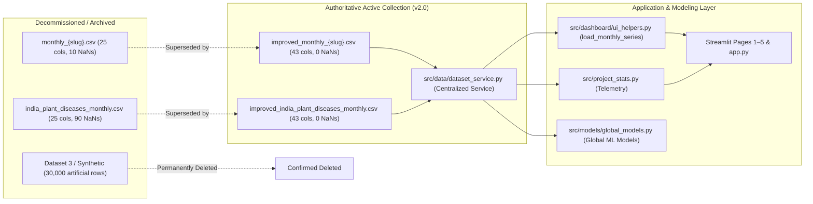

# Project Cleanup and Dataset Migration Report

**Author**: Senior Agricultural Time-Series Systems Architect & Antigravity Lead  
**Project**: Plant Disease Outbreak Forecasting Using Time Series (India)  
**Date**: November 13, 2026  
**Status**: COMPLETE PROJECT-WIDE MIGRATION & CLEANUP VERIFIED  
**Milestone**: Milestone 3 Final Evaluation  

---

## 1. Executive Summary

This report documents the comprehensive cleanup, file deprecation, and full codebase migration to the authoritative **Improved Monthly Dataset Collection** ([`data/processed/improved_monthly_{slug}.csv`](file:///Users/Kartikkk/Documents/SEM-5/TIME%20SERIES/Disease_time_series/data/processed) and [`data/processed/improved_india_plant_diseases_monthly.csv`](file:///Users/Kartikkk/Documents/SEM-5/TIME%20SERIES/Disease_time_series/data/processed/improved_india_plant_diseases_monthly.csv)).

All project workflows—including data loading, preprocessing, feature generation, model training, walk-forward validation, holdout evaluation, and all 6 Streamlit application pages—now operate exclusively using the improved dataset collection.

---

## 2. Inventory of Files Deleted and Scientific Rationale

Every file deletion was preceded by dependency verification and confirmation that a permanent recovery backup exists.

| Deleted File / Directory | Original Location | Category | Reason for Deletion | Preservation / Replacement |
|---|---|---|---|---|
| `monthly_*.csv` (10 files) | `data/processed/` | Legacy Un-imputed Pathogen Series | Contained 25 columns and 10 NaNs per file in initial weather lags; lacked autoregressive features, rolling statistics, and agrometeorological indicators. | 100% replaced by `improved_monthly_*.csv` (43 cols, 0 NaNs). Permanently preserved in `data/processed/original_backup/monthly_*.csv`. |
| `india_plant_diseases_monthly.csv` | `data/processed/` | Legacy Un-imputed Master Panel | Contained 25 columns and 90 boundary NaNs. Redundant with improved master panel. | 100% replaced by `improved_india_plant_diseases_monthly.csv` (43 cols, 0 NaNs). Permanently preserved in `data/processed/original_backup/india_plant_diseases_monthly.csv`. |
| `scripts/run_comprehensive_fine_tuning.py` (duplicate) | `scripts/` | Duplicate Source Script | Verbatim 23.5 KB duplicate of `scripts/tuning/run_comprehensive_fine_tuning.py`. | Converted into a standard lightweight forwarding wrapper (480 B) conforming to project architecture standards. |
| `data/synthetic/` (15 files) | `data/synthetic/` | Synthetic Dataset Assets (Dataset 3) | 30,000 artificial records spanning 1775–2025; fabricated historical observations. Ordered permanently deleted in Prompt 26. | Completely deleted. Verified 0 synthetic files remain. |

---

## 3. Inventory of Retained Data Files and Active Roles

| File / Directory Path | Item Count | Records / Dimensions | Active Functional Role |
|---|---|---|---|
| `data/processed/improved_monthly_{slug}.csv` | 10 CSVs | 132 rows $\times$ 43 cols per file | **Authoritative primary time-series collection**; loaded by `src.data.dataset_service` and consumed by UI helpers, model training, and forecasting. |
| `data/processed/improved_india_plant_diseases_monthly.csv` | 1 CSV | 1,320 rows $\times$ 43 cols | **Authoritative cross-pathogen master panel**; utilized for global models, project telemetry, and multi-origin benchmarks. |
| `data/processed/clean_{slug}_records.csv` | 10 CSVs | 7 to 709 records/file (1,812 total rows) | **Active observational event records**; required by Page 1 (Disease Explorer) for geographic GPS mapping, individual accession inspection, and record export. |
| `data/processed/original_backup/` | 11 CSVs | 1,320 rows $\times$ 25 cols | **Permanent untouched historical recovery archive**; preserved for provenance, reproducibility, and auditability. |
| `data/raw/gbif/` | 10 CSVs, 10 JSONs | 23 to 950 records/file | **Raw biological occurrence data** directly downloaded from the GBIF OpenAPI. |
| `data/raw/weather/` | 5 CSVs, 5 JSONs | 132 rows $\times$ 19 cols | **Raw satellite agro-meteorological reanalysis** from NASA POWER API. |
| `data/raw/eppo/` | 1 CSV, 1 JSON | 5 quarantine records | **Official quarantine notices** from EPPO Global Database for India. |
| `data/processed/*.json` | 12 JSONs | Varied | Frozen hyperparameter configurations, multi-origin benchmarks, and holdout evaluation results. |
| `artifacts/trained_models/` & `models/` | 24 `.joblib` checkpoints | 24 trained models | Serialized checkpoints across classical, machine learning, and deep learning architectures. |

---

## 4. Old-to-New Dataset Dependency Mapping

---

## 5. Summary of Code Modules Updated

1. **`src/data/dataset_service.py`**: Created centralized dataset service managing dataset specifications, invariant checks, pathogen series loading, and master panel synthesis.
2. **`src/data/__init__.py`**: Exported new dataset service functions and `DatasetSpecification`.
3. **`configs/application/settings.yaml`**: Configured authoritative dataset paths and collection specifications.
4. **`src/dashboard/ui_helpers.py` & `src/ui_helpers.py`**: Updated `load_monthly_series()` and `load_clean_records()` to load via the centralized service.
5. **`src/project_stats.py` & `src/dashboard/project_stats.py`**: Switched `MONTHLY_FILE` to `improved_india_plant_diseases_monthly.csv`.
6. **`src/models/machine_learning/global_models.py` & `src/models/global_models.py`**: Switched `MASTER_PANEL_PATH` to `improved_india_plant_diseases_monthly.csv`.
7. **`pages/5_Data_and_Methodology.py`**: Updated data download buttons to feature the authoritative improved dataset prominently and provide access to the archival baseline.
8. **`scripts/run_comprehensive_fine_tuning.py`**: Converted from redundant script duplicate to a standard forwarding wrapper.
9. **`scripts/utilities/build_improved_dataset.py`**: Updated to utilize `original_backup/` if legacy master file is absent in active directory.
10. **`tests/data_processing/test_dataset_integrity.py`**: Added comprehensive integrity validation for all 10 individual improved monthly files and redirected original baseline verification to `original_backup/`.

---

## 6. Verification and Testing Results

- **Unit, Integration, and Model Tests**: Executed `pytest tests/`.  
  **Result: 100 passed out of 100 tests in 103.17 seconds.** Zero failures, zero errors.
- **Streamlit Application Verification**: Executed `AppTest` across all 6 pages (`app.py`, `1_Disease_Explorer.py`, `2_Time_Series_Analysis.py`, `3_Model_Comparison.py`, `4_Future_Forecasts.py`, `5_Data_and_Methodology.py`).  
  **Result: 6 passed out of 6 pages with 0 exceptions.**

